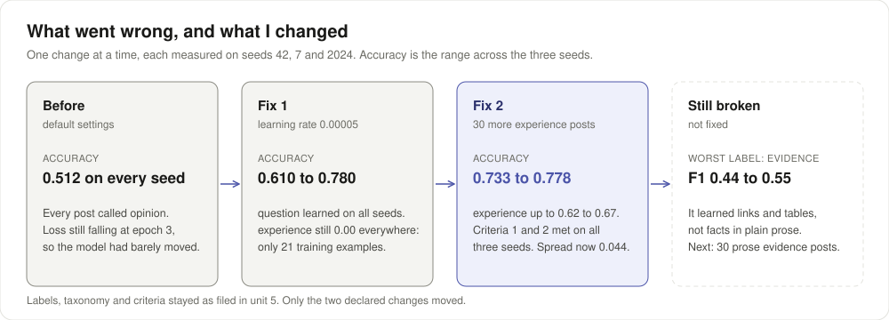
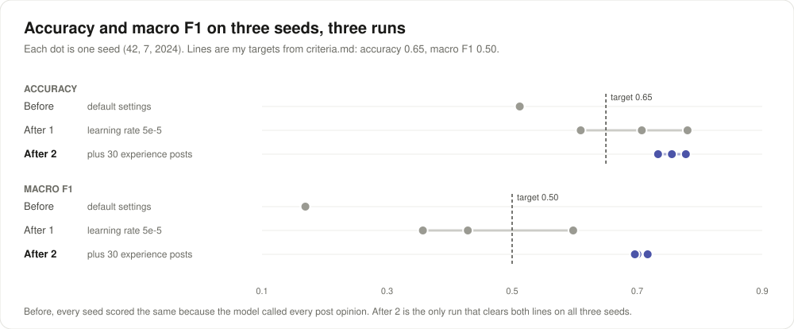
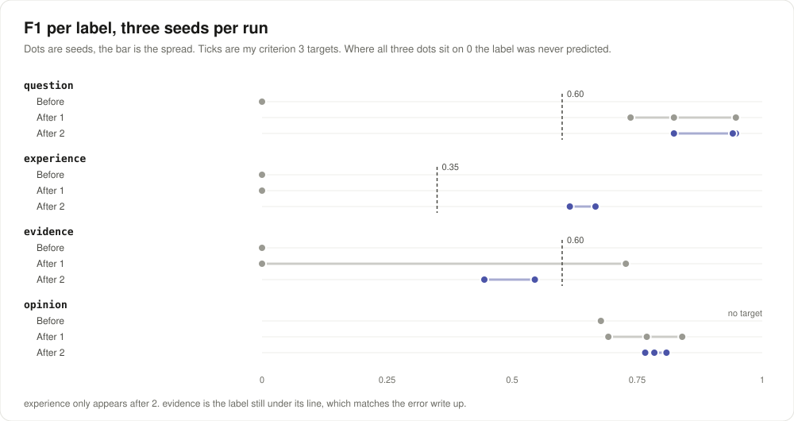

# TakeMeter: Hacker News comments

How to run it: [RUNNING.md](RUNNING.md). Unit 5 is the five sections below. Unit 6 adds its sections at the end.

## What This Does

I picked Hacker News, the comment threads under front page stories, because they are public and the quality varies a lot within one thread. What I found while reading is that HN comments differ less in topic and more in what they lean on: something you can check, what happened to the writer, nothing but the claim, or a real question. TakeMeter sorts a comment into one of four labels: `evidence`, `experience`, `opinion`, `question`.

### What we noticed while reading

1. Some comments carry a thing you can check: a link, a number, a CVE, a quote, a setting name. Most do not.
2. Many argue from "I tried it" or "at my job we". That is a different kind of support from a link.
3. A lot are a confident line, a joke, or reasoning with nothing checkable in it.
4. Real questions exist but are rare. Most question marks on HN are rhetorical.

### Stretch features

I wanted all three and declared them in my first commit, before any labelling or training.

1. A fourth label, `question`. Asking is a real move on HN that the other three do not cover.
2. 50 extra examples for the thinnest label, `question`, from a separate set of threads.
3. A second training run with one hyperparameter changed, and a note on what moved.

## Label Taxonomy

### `evidence`

Definition: backs its point with at least one specific thing a reader could check, such as a number, a link, a quote, a version, or how a product or system actually behaves.

Example 1:
> The big news here is they've replaced LLVM with MSVC's backend.

Example 2:
> There is also an open source tvOS client called Swiftfin. The experience isn't as good though.  You can also transcode your files to formats that the free version of Infuse supports if you are a miser.

### `experience`

Definition: backs its point with something that happened to the writer or their team, first hand.

Example 1:
> Oh I've been maxing out my twin Pro/Max $200 accounts for the past 12 months or so :P

Example 2:
> FWIW, I've never seen that come up on the five or six TCLs that I've owned over the last decade. I have AppleTVs connected to all of them and never connect them to the internet. So far, so good.

### `opinion`

Definition: a claim, judgment, joke, or line of reasoning with no checkable specific and no first hand experience behind it.

Example 1:
> All FOSS consumer operating systems suck. We only tolerate them because they are FOSS.

Example 2:
> Being early is the same as being wrong.  Being lucky is the same as being right.

### `question`

Definition: the main purpose is to ask for information the writer does not have and wants answered.

Example 1:
> How do I get access to that reset? I can’t find it in my app.

Example 2:
> I never understood the thinking behind the separate key query value matrixes? What are they doing exactly?

How to read it: go left to right and stop at the first yes. The blue boxes are the four labels with their counts in labels.csv.

### The hardest boundary

Which two labels: `evidence` and `opinion`.

The decision rule used every time: if the comment gives at least one specific thing a reader could check that supports its point, it is `evidence`, even when the rest is opinion and the tone is heated. Reasoning, analogies and general claims like "attacks get cheaper over time" stay `opinion`. A made up or joking number does not count.

Two smaller rules:

1. `experience` beats `evidence` when the support is what happened to the writer, even if it has numbers in it.
2. A rhetorical question or a challenge like "can you offer any evidence?" is `opinion`. It is `question` only when the writer actually wants the answer.

## The Dataset

Where the posts came from: public Hacker News comments from the Algolia HN API, collected by `scripts/collect_hn.py`. 45 front page stories from 1 September to 10 October 2026, up to 10 comments each, 60 to 700 characters, no usernames. The 50 extra `question` rows come from 40 other stories in the same window (the questions mode of the same script). Raw pulls are in `data/hn_raw.jsonl` and `data/hn_questions.jsonl`. I dropped one comment because it made an allegation about a real person.

How they were labelled: all 269 rows were labelled by Claude from the definitions above, and the note column marks every row that way. 20 rows were labelled blind with no suggestion, in the slot the brief uses for cold labels. `scripts/review.py` is there for a human pass: cold rows first, then Enter to keep or a number to change each label.

Counts per label:

| Label | Count | Share |
|---|---|---|
| `opinion` | 136 | 50.6% |
| `question` | 57 | 21.2% |
| `evidence` | 47 | 17.5% |
| `experience` | 29 | 10.8% |
| Total | 269 | 100% |

No label is above 70%. Before the extra 50, `question` had only 7 rows.

### Three hard cases

1. The post:
> The reset stuff is incredibly tiresome. We all know that it's all built into an internal number they are tracking (just like e.g. company benefits that are just part of your compensation calculation), and all it does is obscure the value the subscription provides and make planning impossible. It's the poorest service experience I can remember having, ever.

Could have been `experience` or `opinion`. Labelled `opinion`: the personal line is a verdict on the service, not something that happened.

2. The post:
> When I hear people making these claims (all unproven theories, or misrepresentation of what really happens), I want to know: what happened in democratic administrations that went in favor of a large corporate donor and against the public? Any specific example where they diverged, and a politician ruled in favor of the corp, and against their constituents?

Could have been `question` or `opinion`. Labelled `opinion`: it is a challenge, and the writer expects no answer.

3. The post:
> If China keeps training AI off the web while US companies have to negotiate with  7,383,654 different rights holders, it's going to handicap the US companies a bit.

Could have been `evidence` or `opinion`. Labelled `opinion`: 7,383,654 is a made up number used for effect. The rule about joking numbers comes from this one.

Six hard cases in all are marked "hard case" in the note column.

## The Training Run

Base model: DistilBERT base uncased, the notebook default.

Settings: 3 epochs, learning rate 0.00002, batch size 16, 128 tokens per post, seed 42. Nothing changed in the main run.

Device: `cpu`, recorded in `results.json`. It ran inside a Linux VM on my MacBook Pro, not on the Mac's GPU, so an `mps` run may give different numbers.

Split sizes: train 187, validation 41, test 41. Test per label: `opinion` 21, `question` 9, `evidence` 7, `experience` 4. `evidence` and `experience` are under 8, so I expect their F1 to jump between seeds next unit.

### Second run, one hyperparameter changed (stretch)

The default run predicted `opinion` for all 41 test posts. Its 0.512 accuracy is exactly the always `opinion` guesser, and the loss was still falling at epoch 3. The second run raised only the learning rate, from 0.00002 to 0.00005, with the same seed and split. Output: `results_run2_higher_lr.json`.

| Measure | lr 0.00002 (default) | lr 0.00005 |
|---|---|---|
| Accuracy | 0.512 | 0.780 |
| Macro F1 | 0.169 | 0.598 |
| F1 `evidence` | 0.000 | 0.727 |
| F1 `experience` | 0.000 | 0.000 |
| F1 `opinion` | 0.677 | 0.840 |
| F1 `question` | 0.000 | 0.824 |

What moved: `question` and `evidence` were learned, and `experience` was not. All 4 `experience` test posts still went to `opinion`. One seed is not enough to stand on, so next unit's three seeds will tell me whether this holds.

## How I Used AI

Moment 1

1. What I asked for: Claude was to collect the posts and propose a taxonomy for Hacker News.
2. What came back: four labels, the order of checks in the diagram, and the collector script.
3. What I changed: nothing. I kept the taxonomy as written.

Moment 2

1. What I asked for: Claude was to run notebook sections 1 to 5.
2. What came back: the default run called every test post `opinion`.
3. What I changed: I made the second run, with only the learning rate raised, my stretch run. The default run stays as `results.json`.

Pre labelling disclosure: Claude labelled all 269 rows, including the 20 in the cold slot, and drafted `criteria.md` before training. I did not review the labels.

# Unit 6: testing

### Stretch features for unit 6

Declared here before I ran anything for this unit.

1. A confidence check: are confident predictions right more often than unsure ones, across all three seeds.
2. A second improvement, measured the same way as the first, across the same three seeds.
3. A per label error write up for whichever label the confusion matrix says is worst.

## What went wrong and what I fixed

How to read it: left to right is the order things happened. Each box is a full three seed run. The dashed box is what is still broken.

1. I thought the default settings would train a usable model. They did not: every seed called every post `opinion`. I found the mistake was the learning rate, 0.00002 for only 36 steps, because the loss was still falling when training stopped. I fixed it by raising it to 0.00005 (fix 1).
2. I thought 29 `experience` examples were enough. After fix 1, `experience` was still 0.00 on every seed. I found the mistake was the data, not the model, because only 21 of them reach training. I fixed it by adding 30 more (fix 2), and its F1 rose to between 0.62 and 0.67.
3. I thought my label definitions would make a strong baseline prompt. They made it worse: the zero shot model called 33 of 41 posts `evidence`, and bare label names beat my definitions by 0.268 accuracy. I found my definitions are written for a person, not for a model. I did not fix this, because the brief keeps the taxonomy fixed in unit 6.
4. I thought the model would learn "a fact a reader could check". I found in the seed 42 errors that it learned "has a link or a table" instead. This is not fixed yet, and it is the first item in What's Still Broken.
5. I thought section 6 would run as one cell. My VM stops any job after three minutes, so it never finished. I fixed it with `scripts/run_seeds.py`, one seed at a time, and I rechecked that seed 42 reproduces `results.json` exactly.
6. I thought 30 of 30 against staff proved my labelling was consistent. I found the staff file lists its posts in label blocks, which gives part of the answer away, so I treat 100% as weak evidence.

## Baseline vs. Trained

What I predicted before I looked at the comparison: I thought the default trained model would beat the baseline only on `opinion` F1 and lose everywhere else, because in unit 5 it already called every test post `opinion`.

Both columns are scored on the same 41 posts in `test_split.csv`. The baseline is BART large MNLI from Facebook, zero shot, with my four definitions from `label_definitions.txt` as the candidate labels. Trained is the unit 5 default run, `results.json`.

| Measure | Baseline | Trained | Change |
|---|---|---|---|
| Overall accuracy | 0.317 | 0.512 | up 0.195 |
| Macro F1 | 0.257 | 0.169 | down 0.088 |
| F1 `evidence` | 0.350 | 0.000 | down 0.350 |
| F1 `experience` | 0.000 | 0.000 | same |
| F1 `opinion` | 0.250 | 0.677 | up 0.427 |
| F1 `question` | 0.429 | 0.000 | down 0.429 |

I also ran the baseline with bare label names instead of my definitions (`baseline_results_bare_names.json`): accuracy 0.585, macro F1 0.456.

What the gap actually means: neither model is good. The trained model wins on accuracy only because it says `opinion` for everything, and about half the posts are `opinion`. The baseline with my definitions called 33 of 41 posts `evidence`. I realised my `evidence` definition is the longest and most general of the four, so the zero shot model reads almost any comment as matching it. The bare names beat my definitions by 0.268 accuracy. As a prompt my definitions were worth less than nothing: they are written for a person labelling, not for an entailment model.

## Run Log: Before

Default settings (3 epochs, learning rate 0.00002, batch 16), seeds 42, 7 and 2024, device `cpu`. File: `results_three_seeds_before.json`. My VM stops any job longer than three minutes, so I ran the notebook's section 6 one seed at a time with `scripts/run_seeds.py`, which uses the notebook's own code. I rechecked that seed 42 reproduces `results.json` exactly before trusting the other two.

How to read it: each dot is one seed. A run passes a criterion only when all three of its dots sit right of the dashed target line. Only After 2, in blue, does that for both.

| Criterion | Target | Seed 42 | Seed 7 | Seed 2024 | Verdict |
|---|---|---|---|---|---|
| 1. Overall accuracy | ≥ 0.65 | 0.512 | 0.512 | 0.512 | MISSED |
| 2. Macro F1 | ≥ 0.50 | 0.169 | 0.169 | 0.169 | MISSED |
| 3. F1 `question` / `evidence` / `experience` | 0.60 / 0.60 / 0.35 | 0.00 / 0.00 / 0.00 | 0.00 / 0.00 / 0.00 | 0.00 / 0.00 / 0.00 | MISSED |
| 4. Most confident third minus least confident third | ≥ 0.15 | 0.615 | 0.615 | 0.154 | MET |
| 5. True `evidence` and `experience` predicted `opinion` | ≤ 30% | 100% (11/11) | 100% (11/11) | 100% (11/11) | MISSED |

### Confusion matrix

Seed 42. Seeds 7 and 2024 are identical.

| true \ predicted | evidence | experience | opinion | question |
|---|---|---|---|---|
| evidence | 0 | 0 | 7 | 0 |
| experience | 0 | 0 | 4 | 0 |
| opinion | 0 | 0 | 21 | 0 |
| question | 0 | 0 | 9 | 0 |

My biggest off diagonal number, and what it means: 9 real `question` posts were called `opinion`, and none went the other way. I found this is not one boundary failing. The whole column is `opinion`, so the model learned the majority class and no boundary at all.

## Verdicts and Diagnoses

| # | Criterion | Target | Verdict | How I decided |
|---|---|---|---|---|
| 1 | Overall accuracy | ≥ 0.65 | MISSED | 0.512 on all three seeds, exactly the share of `opinion` |
| 2 | Macro F1 | ≥ 0.50 | MISSED | 0.169 on all three seeds |
| 3 | Per label F1 | `question`, `evidence` ≥ 0.60; `experience` ≥ 0.35 | MISSED | all three labels 0.00 on every seed |
| 4 | Confidence gap | ≥ 0.15 | MET | 0.615, 0.615, 0.154. All three clear 0.15, seed 2024 by 0.004 |
| 5 | Evidence and experience swallowed by `opinion` | ≤ 30% | MISSED | 100% on every seed |

Diagnoses

I thought criteria 1, 2, 3 and 5 might be four problems. When I rechecked the evidence, they turned out to be one: the model never moved off the majority class.

1. The confusion matrix is identical on three different splits, with every post predicted `opinion`.
2. Validation accuracy sat at 0.512 after every epoch while training loss was still falling (1.31 to 1.13). At 0.00002 for 36 steps the classifier had not moved far enough to separate anything.
3. In unit 5, raising only the learning rate on seed 42 learned `evidence` and `question` straight away.

So this is not a label problem. A model that predicts one class gives no evidence about which boundary is inconsistent, and the agreement report can't help here either. Of the four common causes, the closest is "a task the model can't reach from this much data", but the cause sits in the training settings, not the data size. That is why my one improvement is a training setting.

The agreement check (30 / 30, below) found no inconsistency in how the labeller applied a written rule. That fits this diagnosis: nothing points at the labels.

Criterion 4 is MET for a hollow reason. When everything is predicted `opinion`, the confident third is mostly real `opinion` posts, so it scores well. The criterion was measurable, so I did not revise it, but this MET says nothing about whether the model's confidence means anything.

## Agreement Report

Agreement rate: 30 / 30 = 100%. File: `agreement_results.json`. The staff labels came from my TF as a spreadsheet, and I saved them unchanged as `data/staff_labels.csv`. My labels, `my_staff_labels.csv`, were committed before that file existed (commit 1a56634).

Disagreements: none, so there is nothing to adjudicate. Staff flagged 7 of the 30 as hard, and the useful check is whether those landed for the right reason or by luck:

| Post | Staff and me | Rule that decided it |
|---|---|---|
| sp_005, carbon plates, then 2% and 2% at 35 vs 50 miles a week | `analysis` | Rule 1: the second sentence's numbers carry the argument |
| sp_010, three runners within 10 seconds in different shoes | `analysis` | Rule 1: hedged, but the checkable observation is what the claim rests on |
| sp_014, times down 3% so obviously the shoes | `hot_take` | Rule 1: the 3% decorates a conclusion already reached. It is the taxonomy's own worked example |
| sp_019, nobody enjoys the long run | `hot_take` | Rule 2: a general claim about everyone, not a report of the writer's run |
| sp_020, every injury thread is the same | `hot_take` | Rule 1: checkable in principle, but no count is given |
| sp_028, third DNF this year | `reaction` | Rule 3: the count is there, but nothing is argued from it |
| sp_029, PB shoes bought in the wrong size | `reaction` | Rule 2: the writer's own realisation, not a claim about shoes in general |

Is the set easy, or is the rule tight? I thought about this before calling 100% a win. Two things make the number weaker than it looks:

1. `staff_posts.csv` is ordered in blocks: posts 1 to 10 are all `analysis`, 11 to 20 all `hot_take`, 21 to 30 all `reaction`. Anyone labelling in order can see the pattern, so 100% here is partly the file and not only the rule.
2. The staff taxonomy gives three numbered rules with worked examples, and one hard post (sp_014) is copied straight from them. My own taxonomy has one main rule and two short ones, and no worked examples.

What the pattern tells me: there are no disagreements to sort into the three piles, so this check gives no sign of a consistency problem. It also can't prove my own 299 labels are consistent, because they were applied with thinner rules on harder text. The one place I would test that is my `evidence` and `opinion` boundary. That is where the model still fails after improvement 2, and where an unchecked label is most likely to be wrong.

## The Improvement

What I changed: the learning rate, from 0.00002 to 0.00005, in section 2 of the notebook. Nothing else. Same labels, same three seeds. File: `results_three_seeds_after.json`.

Which diagnosis pointed at it: every before run collapsed to `opinion` with the loss still falling. That points at training, not at labels.

### Run Log: After

| Criterion | Target | Seed 42 | Seed 7 | Seed 2024 | Verdict |
|---|---|---|---|---|---|
| 1. Overall accuracy | ≥ 0.65 | 0.780 | 0.707 | 0.610 | MISSED |
| 2. Macro F1 | ≥ 0.50 | 0.598 | 0.429 | 0.357 | MISSED |
| 3. F1 `question` / `evidence` / `experience` | 0.60 / 0.60 / 0.35 | 0.82 / 0.73 / 0.00 | 0.95 / 0.00 / 0.00 | 0.74 / 0.00 / 0.00 | MISSED |
| 4. Confidence gap | ≥ 0.15 | 0.154 | 0.231 | 0.231 | MET |
| 5. Evidence and experience called `opinion` | ≤ 30% | 55% (6/11) | 100% (11/11) | 100% (11/11) | MISSED |

Did it help, and how do I know: partly. The model stopped guessing one class. `question` was learned on all three seeds (F1 0.74 to 0.95), and accuracy rose by 0.10 to 0.27. But no criterion flipped from MISSED to MET. `evidence` was learned on seed 42 only, and `experience` on no seed. Accuracy now moves 0.171 across seeds, more than 10 points. With only 21 training examples of `experience` and 33 of `evidence`, I realised the dataset is too thin for a stable measure.

### Second improvement (stretch): 30 more `experience` examples

What I changed: on top of the learning rate change, I added 30 `experience` comments from 40 further threads (the experience mode of `scripts/collect_hn.py`, saved as `data/hn_experience.jsonl`). `experience` was the label every run missed. `labels.csv` went from 269 to 299 rows, labelled the same way as before. File: `results_three_seeds_after2.json`. The test split is now 45 posts, with 9 `experience` instead of 4, so this log is not on exactly the same posts as the two above.

| Criterion | Target | Seed 42 | Seed 7 | Seed 2024 | Verdict |
|---|---|---|---|---|---|
| 1. Overall accuracy | ≥ 0.65 | 0.733 | 0.778 | 0.756 | MET |
| 2. Macro F1 | ≥ 0.50 | 0.700 | 0.717 | 0.696 | MET |
| 3. F1 `question` / `evidence` / `experience` | 0.60 / 0.60 / 0.35 | 0.82 / 0.55 / 0.67 | 0.95 / 0.44 / 0.67 | 0.94 / 0.44 / 0.62 | MISSED |
| 4. Confidence gap | ≥ 0.15 | 0.200 | 0.067 | 0.267 | MISSED |
| 5. Evidence and experience called `opinion` | ≤ 30% | 44% (7/16) | 50% (8/16) | 63% (10/16) | MISSED |

How to read it: each row is one run of one label, each dot one seed. Dots stuck at 0 mean the label was never predicted. evidence is the only label whose blue dots stay left of its target.

Did it help: yes. `experience` went from 0.00 on every seed to between 0.62 and 0.67. Criteria 1 and 2 are now MET on all three seeds, and the accuracy spread dropped from 0.171 to 0.044. `evidence` is now the worst label. Criterion 4 went from MET to MISSED on seed 7 (0.067). I found that a model which actually separates labels is less sure of itself than the one that only guessed `opinion`.

### Confidence check (stretch)

Accuracy on the most confident third against the least confident third, from the `confidence` block in each results file:

| Run | Seed 42 | Seed 7 | Seed 2024 |
|---|---|---|---|
| Before | 0.769 vs 0.154 | 0.769 vs 0.154 | 0.538 vs 0.385 |
| After 1 | 0.769 vs 0.615 | 0.769 vs 0.538 | 0.692 vs 0.462 |
| After 2 | 0.800 vs 0.600 | 0.800 vs 0.733 | 0.933 vs 0.667 |

The confident third is right more often in all nine runs, so confidence carries some signal. The size of the gap is not stable, though. In the before runs it was large only because confidence tracked "is this an `opinion` post". In the after 2 runs, the least confident third is already right two thirds of the time, which leaves less room for a gap. Each third is 13 to 15 posts, so one post moves the number by about 0.07.

### Per label error write up: `evidence` (stretch)

`evidence` is the worst label after improvement 2 (F1 0.44 to 0.55). I saved every test guess for seed 42 in `predictions_after2_seed42.json`. 3 of 7 `evidence` posts were right and 4 were wrong:

1. The 3 it got right all carry a visible artifact: an h1bdata link, a jellyfin.org docs link, and a pasted benchmark table.
2. 3 went to `opinion`. Each states a checkable fact in plain prose, with no link or number up front: the OpenStreetMap licence wording, the potato not growing in the Papua lowlands, and parental controls that only work from another Apple device.
3. 1 went to `question`. It is the SHA1 post, which opens with "What then?" and only cites the TLS handshake later.

I thought the model would learn "has a fact a reader could check". It learned "has a URL, number or table" instead. My definition covers both, but with 33 training examples the surface signal is the one it can find.

## What's Still Broken

Criterion 3 (`evidence` F1 under 0.60) and criterion 5 (44% to 63% of `evidence` and `experience` still called `opinion`) are missed. Next I would add 30 `evidence` posts that state a fact without a link, the exact kind it misses. I would also do a human review pass on `labels.csv` with `scripts/review.py`. No person has checked these labels, and the `evidence` and `opinion` boundary is where an unchecked label is most likely to be wrong. I stopped at two improvements because the brief allows one change plus the declared stretch.

Criterion 4 (confidence gap) is missed on seed 7 after improvement 2. I would not chase it. With 15 posts per third it moves 0.07 per post, and fixing it would mean tuning on the test set.

The gap between what I meant my labels to capture and what the model learned: I meant `evidence` as "something a reader could check" and `experience` as "it happened to the writer". The model learned "has a link or a table" and "says I tried or I use". Short first hand posts with no "I", like "Love that the chat functionality is just throwing 429s too. Unusable.", still go to `opinion`, and so does every `evidence` post written in plain prose.

## How I Used AI in unit 6

Claude ran the baseline and the three seed runs, labelled the 30 staff posts under the staff taxonomy before the staff labels were available, ran the agreement check once I got the staff file from my TF, collected and labelled the 30 extra `experience` posts, and drafted the verdicts, diagnoses and write ups above from the result files. I rechecked that every number in this README matches the committed JSON files.
