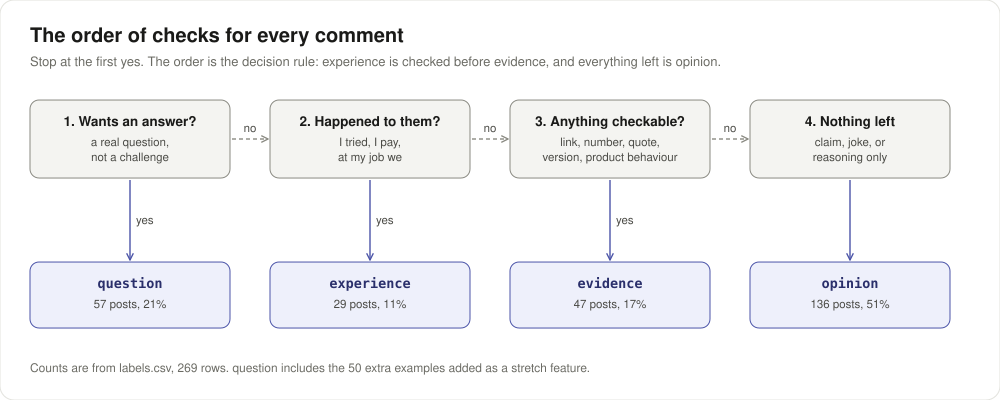

# TakeMeter: Hacker News comments

How to run it: [RUNNING.md](RUNNING.md). Unit 5 is the five sections below. Unit 6 adds its sections at the end.

## What This Does

I picked Hacker News, the comment threads under front page stories, because they are public and the quality varies a lot within one thread. What I found while reading is that HN comments differ less in topic and more in what they lean on: something you can check, what happened to the writer, nothing but the claim, or a real question. TakeMeter sorts a comment into one of four labels: `evidence`, `experience`, `opinion`, `question`.

### What we noticed while reading

1. Some comments carry a thing you can check: a link, a number, a CVE, a quote, a setting name. Most do not.
2. Many argue from "I tried it" or "at my job we". That is a different kind of support from a link.
3. A lot are a confident line, a joke, or reasoning with nothing checkable in it.
4. Real questions exist but are rare. Most question marks on HN are rhetorical.

### Stretch features

I wanted all three and declared them in my first commit, before any labelling or training.

1. A fourth label, `question`. Asking is a real move on HN that the other three do not cover.
2. 50 extra examples for the thinnest label, `question`, from a separate set of threads.
3. A second training run with one hyperparameter changed, and a note on what moved.

---

## Label Taxonomy

### `evidence`

Definition: backs its point with at least one specific thing a reader could check, such as a number, a link, a quote, a version, or how a product or system actually behaves.

Example 1:
> Yes, here's the graph of weekly downloads: https://stats.documentfoundation.org/downloads#week,version The 26.8 peak is within the normal range of week-to-week variation.

Example 2:
> Google is also seriously dropping the ball in terms of security. The CVE-2026-43499 root LPE (aka ghostlock) is still unpatched across all Pixel devices, on the latest """security""" update, despite weaponized exploits being public for months.

### `experience`

Definition: backs its point with something that happened to the writer or their team, first hand.

Example 1:
> i just tested and `mise bootstrap` is over twice as fast at installing when a bottle was in the cache. other commands like `status/check` are 20-30x faster. that's without spending much work at all on perf—i'm sure i could bring these numbers down much further.

Example 2:
> FWIW, I've never seen that come up on the five or six TCLs that I've owned over the last decade. I have AppleTVs connected to all of them and never connect them to the internet. So far, so good.

### `opinion`

Definition: a claim, judgment, joke, or line of reasoning with no checkable specific and no first hand experience behind it.

Example 1:
> All FOSS consumer operating systems suck. We only tolerate them because they are FOSS.

Example 2:
> Being early is the same as being wrong.  Being lucky is the same as being right.

### `question`

Definition: the main purpose is to ask for information the writer does not have and wants answered.

Example 1:
> How do I get access to that reset? I can’t find it in my app.

Example 2:
> I never understood the thinking behind the separate key query value matrixes? What are they doing exactly?

### The hardest boundary

Which two labels: `evidence` and `opinion`.

The decision rule used every time: if the comment gives at least one specific thing a reader could check that supports its point, it is `evidence`, even when the rest is opinion and the tone is heated. Reasoning, analogies and general claims like "attacks get cheaper over time" stay `opinion`. A made up or joking number does not count.

Two smaller rules:

1. `experience` beats `evidence` when the support is what happened to the writer, even if it has numbers in it.
2. A rhetorical question or a challenge like "can you offer any evidence?" is `opinion`. It is `question` only when the writer actually wants the answer.

---

## The Dataset

Where the posts came from: public Hacker News comments from the Algolia HN API, collected by `scripts/collect_hn.py`. 45 front page stories from 1 September to 10 October 2026, up to 10 comments each, 60 to 700 characters, no usernames. The 50 extra `question` rows come from 40 other stories in the same window (`--questions`). Raw pulls are in `data/hn_raw.jsonl` and `data/hn_questions.jsonl`. I dropped one comment because it made an allegation about a real person.

How they were labelled: all 269 rows were labelled by Claude from the definitions above, and the note column marks every row that way. 20 rows were labelled blind with no suggestion, in the slot the brief uses for cold labels. `scripts/review.py` is there for a human pass: cold rows first, then Enter to keep or a number to change each label.

Counts per label:

| Label | Count | Share |
|---|---|---|
| `opinion` | 136 | 50.6% |
| `question` | 57 | 21.2% |
| `evidence` | 47 | 17.5% |
| `experience` | 29 | 10.8% |
| Total | 269 | 100% |

No label is above 70%. Before the extra 50, `question` had only 7 rows.

### Three hard cases

1. The post:
> The reset stuff is incredibly tiresome. We all know that it's all built into an internal number they are tracking (just like e.g. company benefits that are just part of your compensation calculation), and all it does is obscure the value the subscription provides and make planning impossible. It's the poorest service experience I can remember having, ever.

Could have been `experience` or `opinion`. Labelled `opinion`: the personal line is a verdict on the service, not something that happened.

2. The post:
> When I hear people making these claims (all unproven theories, or misrepresentation of what really happens), I want to know: what happened in democratic administrations that went in favor of a large corporate donor and against the public? Any specific example where they diverged, and a politician ruled in favor of the corp, and against their constituents?

Could have been `question` or `opinion`. Labelled `opinion`: it is a challenge, and the writer expects no answer.

3. The post:
> If China keeps training AI off the web while US companies have to negotiate with  7,383,654 different rights holders, it's going to handicap the US companies a bit.

Could have been `evidence` or `opinion`. Labelled `opinion`: 7,383,654 is a made up number used for effect. The rule about joking numbers comes from this one.

Six hard cases in all are marked "hard case" in the note column.

---

## The Training Run

Base model: `distilbert-base-uncased`, the notebook default.

Settings: 3 epochs, learning rate 2e-5, batch size 16, 128 tokens per post, seed 42. Nothing changed in the main run.

Device: `cpu`, recorded in `results.json`. It ran inside a Linux VM on my MacBook Pro, not on the Mac's GPU, so an `mps` run may give different numbers.

Split sizes: train 187, validation 41, test 41. Test per label: `opinion` 21, `question` 9, `evidence` 7, `experience` 4. `evidence` and `experience` are under 8, so I expect their F1 to jump between seeds next unit.

### Second run, one hyperparameter changed (stretch)

The default run predicted `opinion` for all 41 test posts. Its 0.512 accuracy is exactly the always-`opinion` guesser, and the loss was still falling at epoch 3. The second run raised only the learning rate, from 2e-5 to 5e-5, with the same seed and split. Output: `results_run2_lr5e-5.json`.

| Measure | lr 2e-5 (default) | lr 5e-5 |
|---|---|---|
| Accuracy | 0.512 | 0.780 |
| Macro F1 | 0.169 | 0.598 |
| F1 `evidence` | 0.000 | 0.727 |
| F1 `experience` | 0.000 | 0.000 |
| F1 `opinion` | 0.677 | 0.840 |
| F1 `question` | 0.000 | 0.824 |

What moved: `question` and `evidence` were learned, and `experience` was not. All 4 `experience` test posts still went to `opinion`. One seed is not enough to stand on, so next unit's three seeds will tell me whether this holds.

---

## How I Used AI

Moment 1

1. What I asked for: Claude was to collect the posts and propose a taxonomy for Hacker News.
2. What came back: four labels, the order of checks in the diagram, and the collector script.
3. What I changed: nothing. I kept the taxonomy as written.

Moment 2

1. What I asked for: Claude was to run notebook sections 1 to 5.
2. What came back: the default run called every test post `opinion`.
3. What I changed: I made the second run, with only the learning rate raised, my stretch run. The default run stays as `results.json`.

Pre-labelling disclosure: Claude labelled all 269 rows, including the 20 in the cold slot, and drafted `criteria.md` before training. I did not review the labels.

<!-- UNIT 6 sections (Baseline vs. Trained, Run Log Before, Verdicts and
     Diagnoses, Agreement Report, The Improvement, What's Still Broken) are
     added next unit. The starter template is in git history. -->
